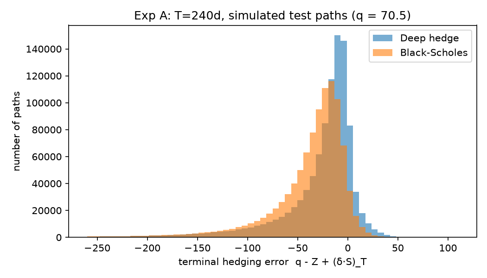
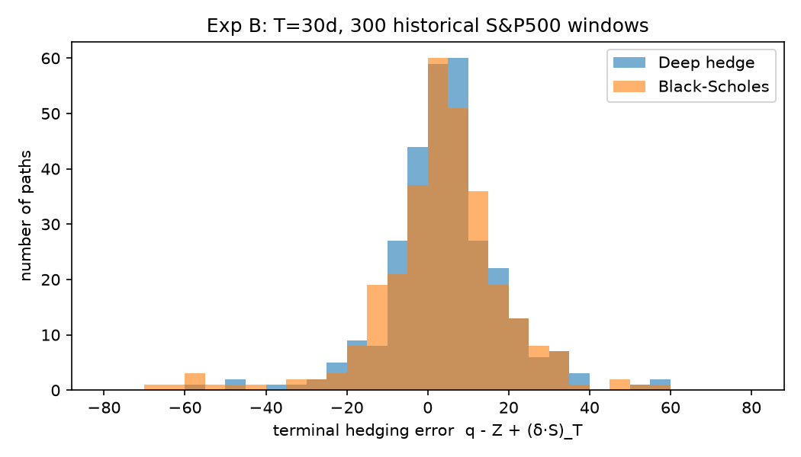

# Deep Hedging: Implementation Plan and Log

**Project:** Reproduce the S&P500 experiment (Section 5.5) of *Deep Hedging*, then apply the method to the Nifty 50.
**Paper:** H. Buehler, L. Gonon, J. Teichmann, B. Wood, *Deep hedging*, Quantitative Finance 19(8), 2019 (published version; the S&P500 experiment is not in arXiv v1).
**Status:** Phase 1 (S&P500): both experiments reproduced. Robustness checks and tidy-up remain.

This document is the living plan for the project. It records what we are reproducing, how each part is built and why, every assumption and deviation from the paper, the problems found along the way, results so far, and the full plan for the remaining work, including the Nifty phase.

---

## Contents

1. [Goal and roadmap](#1-goal-and-roadmap)
2. [What Section 5.5 of the paper does](#2-what-section-55-of-the-paper-does)
3. [Folder layout](#3-folder-layout)
4. [Environment setup](#4-environment-setup)
5. [The pipeline, step by step](#5-the-pipeline-step-by-step)
6. [Experiment protocols](#6-experiment-protocols)
7. [Assumptions (things the paper does not state)](#7-assumptions-things-the-paper-does-not-state)
8. [Deviations from the paper and why](#8-deviations-from-the-paper-and-why)
9. [Problems found and how they were fixed](#9-problems-found-and-how-they-were-fixed)
10. [Results so far](#10-results-so-far)
11. [How to run everything](#11-how-to-run-everything)
12. [Remaining plan: Phase 1 (S&P500)](#12-remaining-plan-phase-1-sp500)
13. [Plan: Phase 2 (Nifty 50)](#13-plan-phase-2-nifty-50)
14. [Open questions](#14-open-questions)
15. [Glossary](#15-glossary)

---

## 1. Goal and roadmap

| Phase | Goal | Status |
|---|---|---|
| **0. Setup** | Python environment, GPU, data download | ✅ done |
| **1A. S&P500, Experiment A** (Figure 12) | 240-day ATM call, MSE objective, simulated test paths | ✅ reproduced (17.2% vs paper's ~20%) |
| **1B. S&P500, Experiment B** (Figure 13) | 30-day ATM call, CVaR objective, 300 historical windows | ✅ reproduced (mean P&L 4.27 vs 3.34; paper 4.3 vs 3.2) |
| **1C. Analysis and robustness** | Statistics, sensitivity checks, final figures | ⏳ next |
| **1D. Documentation** | Final write-up of the S&P results (this file) | 🔄 ongoing |
| **2. Nifty 50** | Same pipeline on Nifty, then improve it into a strong model | ⏳ after Phase 1 |

**Working principles:**
- Every step is explained with its logic.
- Every assumption and every deviation from the paper is written down here, with the reason.
- Code is organised as reusable modules (`src/`) plus runnable experiment scripts (`experiments/`), so the Nifty phase can reuse most of it.

---

## 2. What Section 5.5 of the paper does

**The question:** does deep hedging beat a practitioner's **daily-recalibrated Black–Scholes delta hedge** in a simple, realistic setting where Black–Scholes is known to work well?

**The idea:** the network never sees a model. It only sees simulated price paths. To get realistic paths, the paper fits a standard econometric model (GJR-GARCH with Student-t shocks) to past S&P500 returns, simulates many future paths from it, and trains the hedge on those. The hedge is then tested on simulated paths and on what the S&P500 actually did.

### The two experiments

| | **Experiment A (Figure 12)** | **Experiment B (Figure 13)** |
|---|---|---|
| Data window | S&P500 prices 5 Mar 2013 – 2 Jan 2018 (1,217 returns) | Same window, shifted back 1 week at a time, 300 times (back to 12 Jun 2007 – 10 Apr 2012) |
| Option | ATM European call, K = S₀ | ATM European call, K = S₀ |
| Maturity | T = 240 trading days | T = 30 trading days |
| Rebalancing | every 10 days (24 trades) | weekly, every 5 days (6 trades) |
| Objective | mean squared hedging error, p₀ = q | CVaR (average value at risk), α = 0.75 |
| Tested on | simulated GARCH paths | the **real** next 30 days of the S&P500, in each of 300 windows |
| Paper's result | BS price q ≈ 70.5; deep hedge's mean squared error ~20% lower than BS | mean P&L 4.3 (deep) vs 3.2 (BS); a loss figure of −7.9 (deep) vs −11.6 (BS) |

### Train/test split inside one window
From the 1,217 returns, the first 1,217 − T are "the past" (used to fit GARCH and train the network) and the last T are "the future" (only used for testing). The last training day is "today", k = 0.

### Fair comparison
Both strategies are charged the **Black–Scholes price q**, not the deep hedge's own indifference price. Otherwise the deep hedge would look better just by charging a higher premium.

---

## 3. Folder layout

```
Implementation-S&P500/
├── README.md                  ← this file
├── .venv/                     ← Python 3.13 virtual environment (not code)
├── data/
│   └── sp500_gspc_daily.csv   ← ^GSPC daily closes, 2006-01-03 .. 2018-01-31
├── src/                       ← reusable modules
│   ├── data.py                ← Step 1: download, log-returns, train/test windows
│   ├── garch.py               ← Step 2: GJR-GARCH-t fit, filter, GPU simulation
│   ├── black_scholes.py       ← Step 3: BS price, delta, benchmark hedge
│   ├── network.py             ← Step 4: semi-recurrent deep hedging network
│   ├── train.py               ← Step 5: objectives (MSE, CVaR), training loop
│   ├── evaluate.py            ← Step 6: hedging errors, metrics, histograms
│   └── multi.py               ← speed-up: train many windows at once (Experiment B)
├── experiments/
│   ├── check_garch_bs.py      ← sanity check of Steps 1-3 (q ≈ 70.5?)
│   ├── exp_A_240d.py          ← Experiment A (Figure 12)
│   ├── exp_B_30d.py           ← Experiment B, one window at a time (reference version)
│   ├── exp_B_30d_fast.py      ← Experiment B, vectorised (used for the final run)
│   ├── run_B_resumable.sh     ← auto-restart wrapper for exp_B_30d.py
│   └── analyse_B.py           ← Figure 13 + metrics from the Experiment B CSV
└── results/                   ← one folder per run: results.json / windows.csv, figures, model.pt, logs
```

**Which result folders are "official":**
- Experiment A: `results/exp_A_inputnorm_lr1e-4/`
- Experiment B: `results/exp_B_final_fast/` (in progress)
- Everything else (`*_smoke`, `*_test*`, `exp_A_2M*`, `exp_B_final`, …) is a debugging or comparison run, referred to in Section 9. These will be tidied into `results/archive/` at the end.

---

## 4. Environment setup

| Item | Choice | Why |
|---|---|---|
| Python | **3.13** in a project venv (`.venv/`) | Keeps your global Python 3.14 untouched. Scientific packages like `arch` reliably ship prebuilt wheels for 3.13. |
| Deep learning | **PyTorch 2.7.1 + CUDA 11.8** | The paper used TensorFlow 1.x, which is outdated. The maths is identical in PyTorch. The CUDA 12.6 build failed on this laptop because the NVIDIA driver (528.97, early 2023) is too old; the CUDA 11.8 build works with it. Updating the driver would allow newer PyTorch builds. |
| GPU | RTX 4050 Laptop (6 GB) | Simulation of millions of paths and training are both on GPU. |
| GARCH fitting | `arch` 7.x | Standard, well-tested maximum-likelihood GARCH library. Its GJR-GARCH matches the paper's eq. (37) term for term. |
| Others | numpy, pandas, scipy, matplotlib, yfinance | Data handling, statistics, plots, download. |

Recreate the environment:
```bash
py -3.13 -m venv .venv
./.venv/Scripts/python -m pip install torch==2.7.1 --index-url https://download.pytorch.org/whl/cu118
./.venv/Scripts/python -m pip install arch numpy pandas scipy matplotlib yfinance
```

---

## 5. The pipeline, step by step

### Step 1: Data (`src/data.py`)

- **Source:** Yahoo Finance ticker `^GSPC` (S&P500 price index), daily closes 2006–2018.
- **Log-returns:** r_k = log(S_k / S_{k−1}).
- **Windows:** `get_window(end_date, n_ret=1217, T_days)` returns the last 1,217 returns up to `end_date`, split into train (first 1,217 − T) and test (last T), plus S₀ ("today's" close) and the real future prices S₀, …, S_T.

**Verification against the paper:**
- 5 Mar 2013 – 2 Jan 2018 contains exactly **1,218 prices = 1,217 returns**, as the paper says. (The paper's dates are price dates.)
- 2 Jan 2018 minus 299 weeks = **10 Apr 2012**, the end date of the paper's last window.
- The earliest window, 12 Jun 2007 – 10 Apr 2012, also has 1,218 prices.
- Close = Adj Close for every day, because a price index has no splits or dividends. The paper's word "adjusted" therefore makes no difference.

### Step 2: The market simulator, GJR-GARCH(1,1) with Student-t shocks (`src/garch.py`)

Eq. (37) of the paper:

```
log(S_k / S_{k−1}) = μ + ε_k
ε_k   = σ_k · z_k,          z_k iid Student-t(ν), standardised to variance 1
σ_k²  = ω + α ε_{k−1}² + β σ_{k−1}² + γ ε_{k−1}² · 1{ε_{k−1} < 0}
```

- **What each term does:** μ is the drift; β is volatility memory; α is the reaction to any big move; γ is the *extra* reaction to down-moves (the leverage effect); ν controls tail fatness.
- **Fit:** maximum likelihood via `arch`, on returns scaled ×100 (numerically more stable; parameters are converted back afterwards). Output: μ, ω, α, β, γ, ν, plus today's σ₀ and ε₀.
- **Filter:** `filter_sigma` runs the σ² recursion along an observed return path. This is the practitioner's volatility estimate used by Black–Scholes on the real path.
- **Simulation:** `simulate_paths` is our own GPU Monte Carlo of eq. (37), starting from today's (S₀, σ₀, ε₀). It stores only the rebalancing dates to save memory. Student-t draws use a seeded Marsaglia–Tsang Gamma sampler, so every run is reproducible. 200k paths × 240 days take about 9 s.

### Step 3: Black–Scholes benchmark (`src/black_scholes.py`)

- BS call price and delta with r = 0 and no dividends.
- **Premium:** q = BS price at today's volatility σ₀ (annualised).
- **Hedge:** at each rebalancing date t_j, hold δ_j = N(d₁), computed with the GARCH volatility in force that day.
- Units: σ_annual = σ_daily · √252, τ = remaining trading days / 252.

### Step 4: The network (`src/network.py`)

Semi-recurrent structure (Sections 4–5 of the paper): one small feed-forward network per rebalancing date,

```
δ_j = F_j( log S_j , δ_{j−1} ),   δ_{−1} = 0
F_j : 2 → 20 → 20 → 1,  ReLU hidden activations, linear output
```

- Feeding in the previous position δ_{j−1} is the paper's design. It matters once there are trading costs, and it lets each net "know" what it currently holds.
- 24 nets for Experiment A and 6 for Experiment B. Each has about 520 parameters.
- **Normalisation:** `norm="input"` (our default) standardises log S_j with fixed per-date mean and std computed once from the training paths. `norm="batch"` is the paper's BatchNorm version, kept for comparison. See Sections 8 and 9 for why we switched.

### Step 5: Objectives and training (`src/train.py`)

The terminal hedging error (P&L) on a path is

```
PL = p₀ − Z + Σ_j δ_j (S_{j+1} − S_j),     Z = (S_T − K)⁺
```

| Objective | Formula | Used in |
|---|---|---|
| MSE | E[PL²] with p₀ = q | Experiment A |
| CVaR, α = 0.75 | min over w of { w + E[(−PL − w)⁺] / (1 − α) } = average of the worst 25% of losses | Experiment B |

**Training loop:** sample a random mini-batch of simulated paths, run the 6 or 24 nets forward, compute the loss, take an Adam step (lr = 10⁻⁴, as in the paper). Every few thousand steps, measure the loss on a separate validation set and keep the best weights (early stopping).

**Engineering:**
- The whole training step (forward, backward, Adam) is recorded once as a **CUDA graph** and replayed. Same maths, about 3.5× faster, because 24 tiny networks are otherwise dominated by GPU launch overhead.
- For CVaR, w is set to the exact batch VaR at every step (see Section 8).

### Step 6: Evaluation (`src/evaluate.py`)

- Both strategies are run on the **same** test paths and charged the **same** premium q.
- Metrics: mean P&L, std, MSE, RMSE, CVaR₀.₇₅ of the loss, mean of losses E[min(PL, 0)], 1% and 5% quantiles, median.
- Histogram of the terminal hedging error (Figures 12 and 13 style).

---

## 6. Experiment protocols

### Experiment A (`experiments/exp_A_240d.py`)
1. Window ending 2 Jan 2018, T = 240. "Today" is 19 Jan 2017, S₀ = 2263.69.
2. Fit GARCH on the 977 training returns, giving σ₀ = 8.0% p.a. and q = 70.54.
3. Simulate 2 × 10⁶ training, 2 × 10⁵ validation and 10⁶ test paths (independent seeds), stored every 10 days.
4. Train with MSE, lr = 10⁻⁴, batch 4096, up to 300k steps with early stopping.
5. Compare deep hedge vs BS on the 10⁶ test paths and plot Figure 12.

### Experiment B (`experiments/exp_B_30d_fast.py`)
For each window i = 0, …, 299 (end date = 2 Jan 2018 − i weeks):
1. Take the 1,217 returns ending there; the last 30 are the real future.
2. Fit GARCH on the 1,187 past returns. Compute q at σ₀.
3. Simulate 5 × 10⁵ training, 10⁵ validation and 10⁵ test paths, stored every 5 days.
4. Train with CVaR₀.₇₅, lr = 10⁻⁴, batch 1024, 60k steps, keeping the best validation checkpoint.
5. Evaluate both hedges on the simulated test paths (in-model check) and on the **one real S&P path** (the actual result).
6. Append one row per window to `windows.csv`.

Windows are trained 50 at a time (`src/multi.py`), but each window has its own networks, paths and premium, so each is trained exactly as if alone. Then `experiments/analyse_B.py` builds Figure 13 and the summary statistics.

---

## 7. Assumptions (things the paper does not state)

| # | Assumption | Reason |
|---|---|---|
| A1 | Data = `^GSPC` closes from Yahoo Finance | Free and standard. It reproduces the paper's 1,217-return count exactly. |
| A2 | Interest rate r = 0, no dividends | The paper never mentions either. q = 70.54 matching the paper's 70.5 supports this. |
| A3 | 252 trading days per year (σ_ann = σ_daily √252, τ = days/252) | Standard convention, and confirmed by the q match. |
| A4 | BS volatility at date k = GARCH conditional vol σ_k in force that day | The paper only says "the filter induced by (37)". Using σ_k is consistent with q being priced at σ₀. |
| A5 | "Weekly" = every 5 trading days, "biweekly" = every 10 | The paper's footnote gives t_k = 10k for T = 240. |
| A6 | Real path for window i ends on the last trading day ≤ (2 Jan 2018 − i weeks) | The weekly shift sometimes lands on a holiday. |
| A7 | Hidden layers N₁ = N₂ = 20, input I_k = log S_k plus δ_{k−1} | Stated in 5.5 (N₁, N₂, I_k) and 5.1 (semi-recurrence). |
| A8 | Paper's "mean square hedging loss −11.6 / −7.9" is a different metric | A mean of squares cannot be negative. We report several candidates (mean of losses, CVaR of P&L, …) and will see which matches. |

---

## 8. Deviations from the paper and why

| # | Paper | Ours | Why |
|---|---|---|---|
| D1 | BatchNorm before each ReLU | **No BatchNorm.** Inputs standardised with fixed statistics. | With fat-tailed GARCH paths (infinite 4th moment), BatchNorm's evaluation-mode statistics never match what the network saw in training. Test results swung randomly by ±10%. Fixed input scaling makes training and testing behave identically, which is essential for Experiment B's single real-path tests. Details in Section 9. |
| D2 | Batch size 256 (Section 5.1; 5.5 is silent) | 4096 (A), 1024 (B) | Same cost per step on this GPU and smoother gradients. 1024 for B is a speed/quality compromise. |
| D3 | Number of training steps not stated | Early stopping on a validation set (A); 60k steps with best-checkpoint selection (B) | Needed to pick something; this is a standard, data-driven rule. |
| D4 | 2 × 10⁷ training paths | 2 × 10⁶ (A), 5 × 10⁵ per window (B) | A 2 × 10⁷ run of Experiment A showed the same validation loss as 2 × 10⁶, so more paths don't help here. 5 × 10⁵ keeps 300 windows affordable. |
| D5 | CVaR via OCE with **trainable** w | w = **exact batch VaR** at every step | Same objective (for a fixed network, the optimal w is exactly the VaR). The trainable w got stuck: lr 10⁻⁴ moves it ~10⁻⁴ per step while its optimum drops from ~70 to ~5. See Section 9. |
| D6 | One training run per window | 50 windows trained simultaneously (vectorised) | Pure bookkeeping. Each window has its own parameters and Adam is element-wise, so the result is the same as separate training (verified: CVaR within ±0.4). Takes ~1 hour instead of ~7. |
| D7 | TensorFlow | PyTorch with CUDA graphs | Modern library. CUDA graphs only remove launch overhead; the maths is unchanged. |

---

## 9. Problems found and how they were fixed

This is a record of every non-trivial issue. Each one is a useful lesson for the Nifty phase.

1. **GPU unusable with the CUDA 12.6 PyTorch build.** "CUDA-capable device is busy or unavailable" on any GPU operation. **Cause:** the driver is too old (CUDA 12.0). **Fix:** PyTorch 2.7.1 built for CUDA 11.8.

2. **Training too slow (~21–25 ms/step).** **Cause:** 24 tiny networks mean hundreds of small GPU kernel launches per step. **Fix:** record the step as a CUDA graph and replay it (~7 ms/step), and use a larger batch since it costs nothing extra.

3. **Best-checkpoint bug.** The first comparison was `val < inf − 1e-4·inf`, which is NaN, so nothing was ever saved. **Fix:** always save the first evaluation.

4. **BatchNorm made results unreliable (the biggest issue).**
   - *Symptom:* validation loss jumped between ~4,000 and ~300,000 while training loss was smooth at ~3,600. The test result was 10.6% in one run and 5.7% in another.
   - *Diagnosis:* the same weights scored MSE 3,734 with one set of BN statistics and 4,090 with another. GARCH paths here have an **infinite 4th moment** (the condition value is 1.19 > 1). The average batch variance is inflated by rare extreme batches, while training uses typical batches, so no fixed evaluation statistic matches training.
   - *Attempt:* "precise BN" (recompute statistics over 100 batches) made it worse.
   - *Fix:* remove BatchNorm and standardise inputs with fixed per-date statistics (deviation D1). Validation now tracks training closely (~3,590 vs ~3,550).

5. **CVaR training stuck.** Validation CVaR stayed flat at ~45 (BS: 30.5). **Cause:** w started at the initial network's VaR (~68). The optimum falls to ~5 as the network improves, but Adam at lr 10⁻⁴ moves w only ~10⁻⁴ per step, so only the few paths with loss above 68 gave gradient. (Starting at w = 0 had the mirror problem.) **Fix:** set w to the exact batch VaR each step (deviation D5). Validation CVaR now drops 29.7 → 28.4 within 30 s.

6. **Early stopping too aggressive.** Windows stopped at ~14–18k steps before converging. **Fix:** a minimum number of steps before stopping is allowed, and in the final version a fixed 60k steps with best-checkpoint selection.

7. **Crash after 10 windows ("illegal memory access").** **Cause:** `torch.kthvalue` (used for the batch VaR) is not safe inside a CUDA graph. **Fix:** `sort(loss)[k−1]`, which gives the same value and is graph-safe. Also added an auto-restart wrapper and per-window CSV saving.

8. **Experiment B too slow (~7 hours).** **Fix:** vectorised training of 50 windows at once plus batch 1024. That's about 0.15 ms per window-step, roughly 1 hour total.

9. **Laptop sleep** paused a run for ~6 hours. **Mitigation:** all long runs save progress incrementally and can be resumed. Keep the laptop plugged in and awake during runs.

---

## 10. Results so far

### Sanity check of Steps 1–3 (`experiments/check_garch_bs.py`)

| Quantity | Ours | Paper |
|---|---|---|
| Returns in 5 Mar 2013 – 2 Jan 2018 | 1,217 | 1,217 |
| BS premium q (Experiment A) | **70.54** | ~70.5 |

GARCH fit for Experiment A (training period Mar 2013 – Jan 2017):

| μ | ω | α | γ | β | ν | σ₀ (p.a.) | long-run vol |
|---|---|---|---|---|---|---|---|
| 0.042%/day (~11%/yr) | 4.5e-6 | ≈ 0 | 0.369 | 0.759 | 7.07 | 8.0% | 14.1% |

How to read this: volatility reacts **only** to down-moves (α ≈ 0, γ = 0.37), tails are fat (ν ≈ 7), and today's volatility is low (Jan 2017 was very calm). Simulated returns match the historical mean, volatility (13.7% vs 12.9%) and skew (−0.38 vs −0.38). Kurtosis is extreme because the model's 4th moment is infinite for these parameters. That's a property of the model, not a bug.

### Experiment A: reproduced ✅
`results/exp_A_inputnorm_lr1e-4/` (2 × 10⁶ training paths, 10⁶ test paths)

| Metric (simulated test paths) | Deep hedge | Black–Scholes |
|---|---|---|
| **MSE** | **3,591** | 4,336 → **17.2% lower** (paper: ~20%) |
| Mean P&L | −30.0 | −40.9 |
| Std | 51.9 | 51.6 |
| Median | −15.6 | −28.0 |
| CVaR₀.₇₅ of loss | 89.9 | 100.7 |
| 1% quantile | −237.9 | −246.2 |



**Interpretation:**
- The shape matches the paper's Figure 12: left-skewed, a peak just below 0, and the deep hedge taller and shifted right.
- The deep hedge's gain comes mostly from **shifting the whole distribution right** (mean −30 vs −41). The tails are nearly identical.
- *Why q is "too cheap":* q uses σ₀ = 8%, but GARCH volatility mean-reverts toward 14%, and the paths have an upward drift (~11%/yr). Both make the call pay more than q on average, so both strategies lose on average. The deep hedge partly learns the drift and the volatility mean-reversion from the paths; BS cannot.
- lr 10⁻³ gave 15.6%. The BatchNorm runs gave 10.6% and 5.7%, which are unreliable (see Section 9).

### Experiment B: reproduced ✅
`results/exp_B_final_fast/` (300 windows; "today" ranges from 27 Feb 2012 to 16 Nov 2017; each window tested on the real next 30 trading days)

| Metric (300 real S&P paths) | Deep hedge | Black–Scholes | Paper (deep / BS) |
|---|---|---|---|
| **Mean P&L** | **4.27** | **3.34** | **4.3 / 3.2** |
| **Downside RMS, −√E[min(PL,0)²]** | **−8.19** | **−12.09** | **−7.9 / −11.6** (our best match for the paper's "mean square hedging loss") |
| Std | 14.3 | 17.2 | |
| MSE | 222.6 | 306.3 | |
| CVaR₀.₇₅ of loss | **12.3** | 16.9 | |
| 1% quantile | **−35.6** | −60.0 | |
| 5% quantile | **−17.4** | −21.0 | |
| Median | 4.33 | 4.05 | |
| Deep hedge better in | 52% of windows | | |

In-model (simulated test paths, averaged over windows): CVaR₀.₇₅ **22.8** (deep) vs **25.3** (BS), about 10% better.



**The paper's mystery metric (A8):** "mean square hedging loss −7.9 vs −11.6" is best matched by the **downside root-mean-square error**, −√E[min(PL,0)²]: we get −8.2 vs −12.1. This is our inference; the paper doesn't define it. (Mean of the worst 40% gives −8.0 vs −10.8, a weaker match for BS.)

**Statistical significance (block bootstrap, blocks of 6 and 12 windows, 5,000 resamples, 95% intervals for deep − BS):**

| Quantity | 95% CI | P(deep better) |
|---|---|---|
| Mean P&L difference | [−0.37, +2.42] | 0.91 |
| Downside RMS difference | [+0.3, +6.7] | 0.99 |
| Worst-25% average difference | [+0.4, +9.6] | 0.99 |

**Interpretation:**
- **We reproduce the paper's real-data result.** Mean P&L is 4.27 vs 3.34 (paper 4.3 vs 3.2), and the loss metric is −8.2 vs −12.1 (paper −7.9 vs −11.6).
- The deep hedge's real advantage is in **tail risk**, not the average. The worst 1% loss is −36 vs −60, and the 25% CVaR is 12.3 vs 16.9. Those improvements are statistically significant even after accounting for overlapping windows. That's exactly what a CVaR-trained hedge should deliver.
- The mean P&L improvement (+0.9) is *not* significant on its own (the 95% CI includes 0).
- The deep hedge is better in only 52% of windows: it doesn't win every time, it **loses less when things go badly**. The histogram shows this: BS has more mass in the far left tail (−70 to −40).
- By period, BS did slightly better in the calm, steady 2016–17 rally. The deep hedge did better from 2012 to 2015, which includes more volatile episodes.

---

## 11. How to run everything

From `Implementation-S&P500/`:

```bash
# Steps 1-3 sanity check (q ≈ 70.5?)
./.venv/Scripts/python experiments/check_garch_bs.py

# Experiment A (Figure 12), ~30 min on the RTX 4050
./.venv/Scripts/python experiments/exp_A_240d.py --n_train 2000000 --lr 1e-4 --tag _inputnorm_lr1e-4

# Experiment B (Figure 13), ~1 h, resumable (rerun the same command after a crash or sleep)
./.venv/Scripts/python experiments/exp_B_30d_fast.py --windows 0:300 --group 50 --batch 1024 --tag _final_fast

# Figure 13 + statistics
./.venv/Scripts/python experiments/analyse_B.py --tag _final_fast
```

Useful options: `--norm batch` (paper's BatchNorm version, A only), `--n_train`, `--lr`, `--batch`, `--windows a:b`, `--tag`.

---

## 12. Remaining plan: Phase 1 (S&P500)

### 12.1 Finish Experiment B
- [ ] Let the 300-window run finish.
- [ ] Check quality: batch 1024 vs batch 4096 on windows 0–9 (similar simulated CVaR expected).
- [ ] Run `analyse_B.py`: Figure 13, mean P&L (paper 4.3 vs 3.2), and work out which metric matches the paper's "−7.9 vs −11.6".

### 12.2 Statistical honesty
The 300 windows overlap (30-day test periods shifted by 1 week share ~5/6 of their days), so they are **not** 300 independent observations.
- [ ] Report a **block bootstrap** confidence interval for mean(deep − BS) (blocks of ≥ 6 windows).
- [ ] Report win rate and results by sub-period (2007–09 crisis, 2010–12, 2013–17 calm bull market).
- [ ] Plot the per-window difference over time.

### 12.3 Sensitivity and ablation checks
Each tells us how robust the result is to our choices:
- [ ] BatchNorm vs input normalisation (Experiment B, a subset of windows).
- [ ] Batch size (256 / 1024 / 4096) and learning rate (10⁻⁴ vs 10⁻³).
- [ ] Number of training paths (10⁵ / 5 × 10⁵ / 2 × 10⁶).
- [ ] BS volatility choice (σ_k vs next-day σ_{k+1} vs GARCH term-structure average vol to maturity). This tests whether a smarter BS closes the gap.
- [ ] Network inputs: add σ_k (filtered vol) and time to maturity as inputs.

### 12.4 Tidy-up and final documentation
- [ ] Move debug runs to `results/archive/`.
- [ ] Rerun the official experiments from a clean state with the final code, for reproducibility.
- [ ] Finalise this README: final results, figures, conclusions, limitations.

**Deliverables of Phase 1:** reproduced Figures 12 and 13, a results table against the paper, a list of deviations, and robustness checks.

---

## 13. Plan: Phase 2 (Nifty 50)

The aim is first to **port** the S&P pipeline to Nifty, then **improve** it into a strong hedging model. Details will be agreed after Phase 1. This is the proposed plan.

### 13.1 Port: same experiment on Nifty
- **Data:** Nifty 50 index (`^NSEI` on Yahoo Finance; NSE's own historical data as a cross-check). Check for gaps and holidays.
- **Folder:** `Implementation-Nifty/`, reusing `src/`. Move shared code into a common package if needed.
- **Re-run Experiments A and B on Nifty** windows with the same protocol, giving a baseline.

### 13.2 India-specific differences to handle
| Topic | S&P setup | Nifty consideration |
|---|---|---|
| Interest rate | r = 0 assumed | Indian rates ~6–7%, so **r ≠ 0** matters for pricing and the BS benchmark. Use the T-bill/MIBOR rate. |
| Dividends | ignored | Nifty dividend yield ~1–1.5%. Include it, or hedge with futures (which embed carry). |
| Trading days | 252 | ~248 per year on NSE; use the actual calendar. |
| Options | European, monthly | Nifty options are European and cash-settled, with **weekly and monthly expiries**. Choose maturities that match real contracts (e.g. 30-day monthly, 7-day weekly). |
| Hedging instrument | the index itself | In practice Nifty is hedged with **Nifty futures** (lot size, margin). Model the future as the hedging instrument. |
| Trading costs | none (only less frequent trading) | Add **proportional costs** (brokerage, STT, exchange fees, slippage). Deep hedging handles these naturally, and it is where it should beat BS most clearly. |
| Implied volatility | not used | **India VIX** and NSE option chains give implied vol. This allows a much stronger BS benchmark (implied-vol BS) and realistic premiums. |

### 13.3 Improve: towards a "very good model"
Candidate improvements, to be tested one at a time against a fixed evaluation protocol:
1. **Better market simulators:** compare GJR-GARCH-t with EGARCH or other GARCH variants, regime-switching models, filtered historical simulation (bootstrapped GARCH residuals), and possibly generative models (e.g. a GAN or VAE for paths). The hedge is only as good as the paths it trains on.
2. **Richer network inputs:** filtered volatility σ_k, time to maturity, India VIX, recent returns, moneyness log(S/K).
3. **Architecture:** a recurrent net (LSTM/GRU) shared across dates instead of one net per date. This allows more dates (daily hedging) and transfer between windows.
4. **Objectives:** CVaR at different α, entropic risk, mean-variance. Choose according to the desk's risk preference.
5. **Transaction costs** in training, which leads to "no-trade band" behaviour.
6. **Multiple instruments:** hedge with futures plus other options (e.g. an ATM option as a vega hedge), as in the paper's Heston example with the variance swap.
7. **Training tricks:** warm-starting across windows, learning-rate schedules, larger networks with proper validation.

### 13.4 Evaluation for Nifty
- Walk-forward backtest over many windows (as in Experiment B), on **real Nifty paths**.
- Benchmarks: BS with GARCH vol, BS with implied vol (India VIX or option chain), and possibly a Heston- or SABR-style hedge.
- Metrics: mean P&L, CVaR, MSE, max loss, turnover, cost paid; block-bootstrap confidence intervals; sub-period analysis (e.g. COVID crash in 2020).

### 13.5 Phase 2 deliverables
- Nifty baseline replication (same as S&P).
- Improved model(s) with ablation tables showing what each change contributes.
- Final report for the RnD: method, results, limitations, recommendations.

---

## 14. Open questions

1. **Paper's "−7.9 vs −11.6" metric:** which quantity is it? We'll test candidates once Experiment B is done.
2. **Batch 1024 vs 4096 for Experiment B:** confirm the quality is equivalent (check pending).
3. **Nifty data sources:** is Yahoo's `^NSEI` enough, or do we have access to NSE option-chain and futures data (needed for implied vol, futures hedging, and realistic costs)?
4. **Target use case for Nifty:** which options (weekly or monthly, ATM or OTM), which risk measure, and which costs? To be agreed with Prof. Baskar.
5. **Driver update:** updating the NVIDIA driver would allow a newer PyTorch. Optional.

---

## 15. Glossary

| Term | Meaning |
|---|---|
| ATM | at the money: strike K = today's price S₀ |
| Terminal hedging error / P&L | q − Z + (δ·S)_T: the seller's final wealth; 0 = perfect hedge |
| CVaR₀.₇₅ | average of the worst 25% of losses (eq. (28) of the paper) |
| VaR₀.₇₅ | the loss level exceeded with 25% probability |
| OCE | optimised certainty equivalent; writes CVaR as min over w of { w + E[(loss − w)⁺]/(1 − α) } |
| GJR-GARCH-t | GARCH with an extra volatility reaction to negative shocks and Student-t innovations |
| Filtered volatility | volatility estimate obtained by running the GARCH recursion on observed returns |
| Semi-recurrent network | separate net per date, with the previous position fed back in as an input |
| CUDA graph | a recorded sequence of GPU operations replayed as one call (removes launch overhead) |
| In-model test | evaluation on fresh paths from the same simulator the network was trained on |
| Window | one (train, test) split of the data; Experiment B uses 300 windows shifted by one week |
