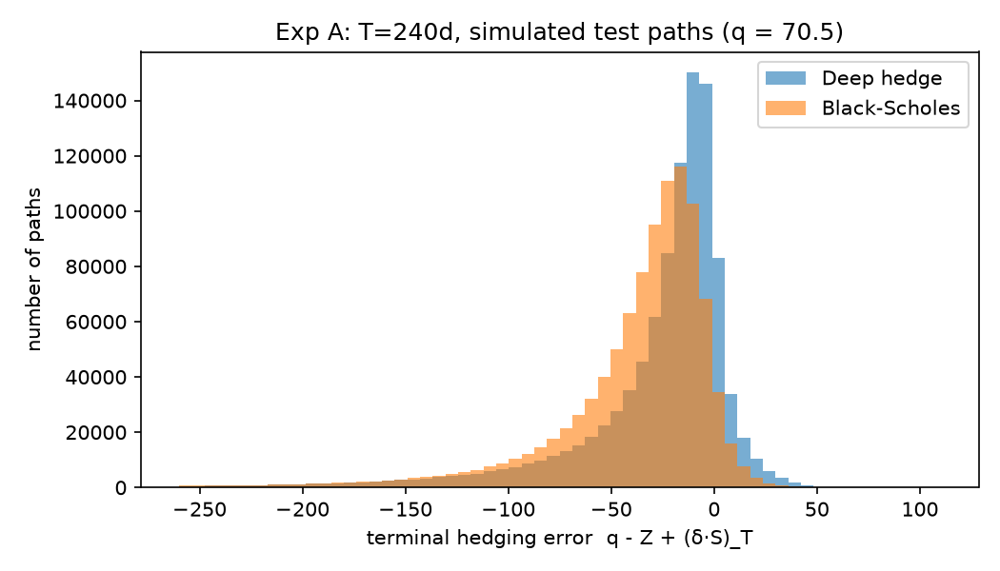
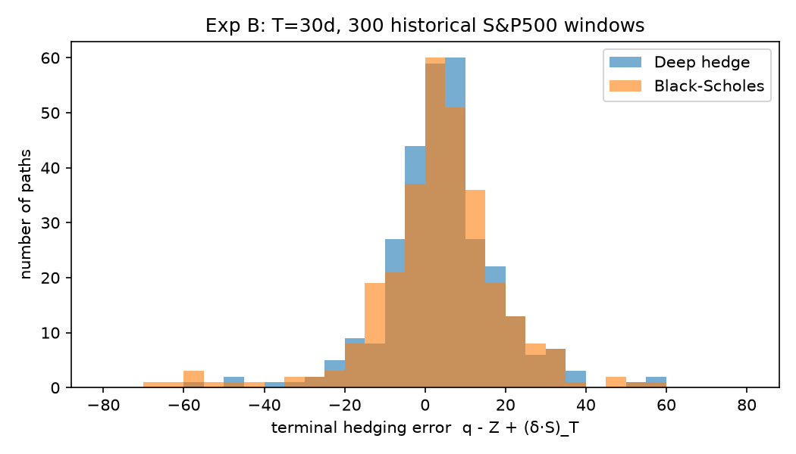

# Deep Hedging: Reproducing the S&P 500 Experiment

A PyTorch reproduction of the S&P 500 experiment (Section 5.5) of:

> H. Buehler, L. Gonon, J. Teichmann, B. Wood. **Deep hedging.** *Quantitative Finance* 19(8), 2019.

A neural network learns to hedge an at-the-money call option on the S&P 500. It is trained on paths simulated from a GJR-GARCH model fitted to historical data, and compared with the classical Black–Scholes delta hedge. Both experiments in the paper are reproduced. The next phase applies the same pipeline to the Nifty 50.

## Results

| Experiment | What it tests | Our result | Paper |
|---|---|---|---|
| **A** (Figure 12) | 240-day call, mean-squared-error objective, simulated test paths | Deep hedge MSE **17.2% lower** than Black–Scholes | ~20% lower |
| **B** (Figure 13) | 30-day call, CVaR objective, 300 real historical S&P windows | Mean P&L **4.27 vs 3.34**; downside RMS **−8.2 vs −12.1** | 4.3 vs 3.2; −7.9 vs −11.6 |

On real data, most of the deep hedge's advantage is in the **tail**. Its worst 1% loss is −36, against −60 for Black–Scholes, and a block bootstrap shows the tail improvement is statistically significant.

| Experiment A | Experiment B |
|---|---|
|  |  |

## Repository contents

```
├── Implementation-S&P500/              ← code, data and results
│   ├── README.md                       ← full implementation log (read this for details)
│   ├── data/                           ← S&P 500 daily closes, 2006–2018
│   ├── src/                            ← reusable modules: data, GARCH, Black–Scholes, network, training, evaluation
│   ├── experiments/                    ← runnable scripts for Experiments A and B
│   └── results/                        ← one folder per run (metrics, figures, logs)
├── Deep hedging - google scholar.pdf   ← the paper
├── Deep_Hedging_presentation.pptx      ← presentation of the method and results
└── Measuring_risk- task 1.pdf          ← survey of mathematical risk measures (coherence axioms, variance, VaR, CVaR, drawdown)
```

The [implementation README](Implementation-S&P500/README.md) explains every step of the pipeline. It also lists every assumption the paper leaves unstated, every deviation from the paper and the reason for it, the problems hit along the way, and the plan for the Nifty phase.

## Pipeline

1. **Data:** download S&P 500 closes and compute log-returns over rolling train/test windows.
2. **Market model:** fit a GJR-GARCH(1,1) model with Student-t innovations, then simulate millions of paths on the GPU.
3. **Benchmark:** Black–Scholes price and delta hedge.
4. **Network:** a semi-recurrent feed-forward network that outputs the hedge position at each step.
5. **Training:** minimise MSE (Experiment A) or CVaR (Experiment B) of the hedging P&L.
6. **Evaluation:** hedging-error statistics, histograms and a bootstrap significance test.

## Setup

Requires Python 3.13 and, ideally, a CUDA GPU (the experiments were developed on an RTX 4050 Laptop GPU).

```bash
cd Implementation-S&P500
py -3.13 -m venv .venv
./.venv/Scripts/python -m pip install torch==2.7.1 --index-url https://download.pytorch.org/whl/cu118
./.venv/Scripts/python -m pip install arch numpy pandas scipy matplotlib yfinance
```

On Linux or macOS, use `python3.13` and `.venv/bin/python`. Choose the PyTorch build that matches your CUDA driver.

## Running

From `Implementation-S&P500/`:

```bash
# Sanity check of data, GARCH and Black–Scholes (premium should be about 70.5)
./.venv/Scripts/python experiments/check_garch_bs.py

# Experiment A (Figure 12), about 30 min on the GPU
./.venv/Scripts/python experiments/exp_A_240d.py --n_train 2000000 --lr 1e-4 --tag _inputnorm_lr1e-4

# Experiment B (Figure 13), about 1 h; resumable
./.venv/Scripts/python experiments/exp_B_30d_fast.py --windows 0:300 --group 50 --batch 1024 --tag _final_fast
./.venv/Scripts/python experiments/analyse_B.py --tag _final_fast
```

## Status

- [x] S&P 500, Experiment A (simulated paths)
- [x] S&P 500, Experiment B (real historical paths)
- [ ] Robustness and sensitivity checks
- [ ] Nifty 50: same pipeline, then improvements
